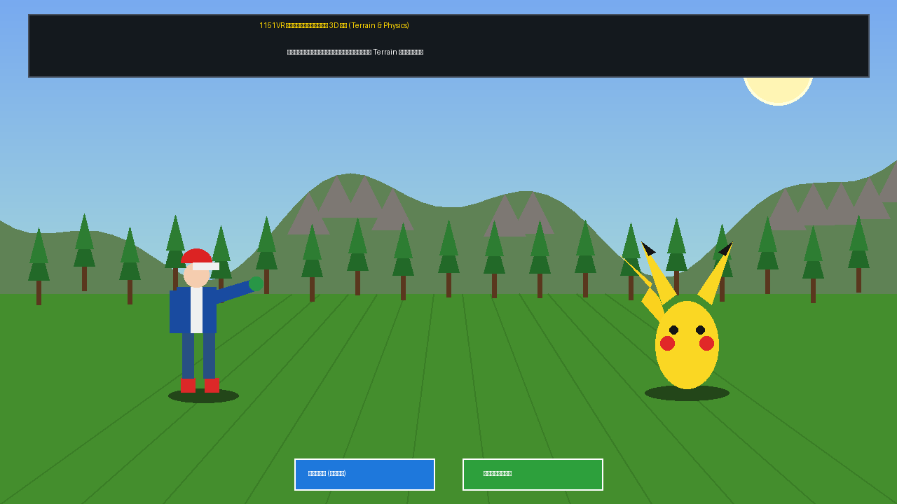
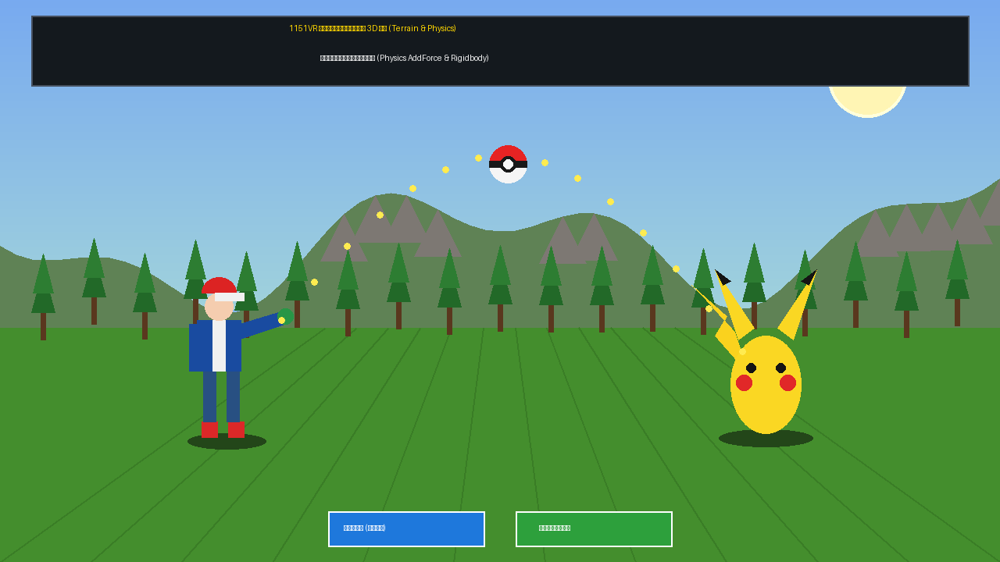
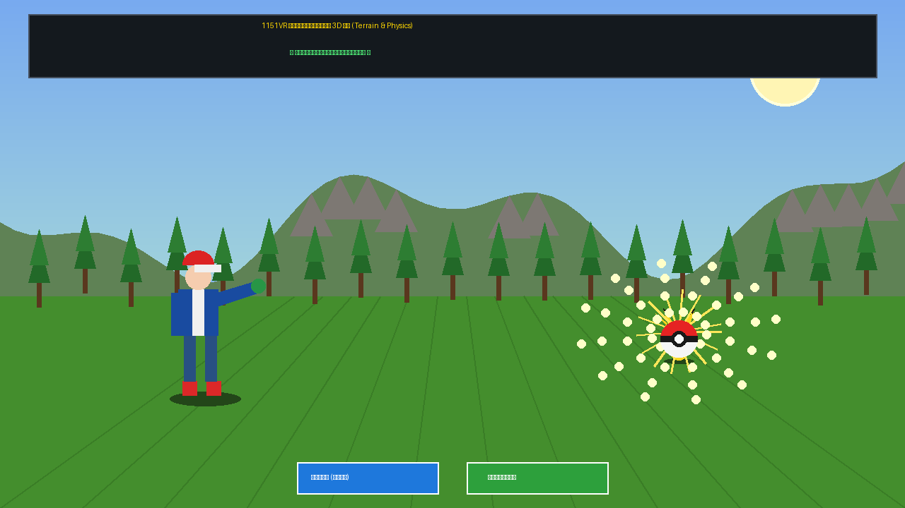

# 1151VR-HW5-414262272-LCH

輔仁大學 資訊工程學系 虛擬實境遊戲設計 作業五：精靈球收服寶可夢 3D 遊戲 (Terrain & Physics)

- **學生學號**：414262272
- **學生姓名**：劉承勳
- **指導教授**：胡臻騏 教授
- **授課信箱**：cchu.fju@gmail.com

---

## 一、專案截圖

### 1. 3D 場景全貌、訓練家與野生寶可夢對峙

> 左側配置 3D 訓練家模型，右側為 3D 野生寶可夢模型，背後為使用 Unity Terrain 系統雕塑的連綿起伏山脈、岩石地貌與森林草地。

### 2. 精靈球由左至右拋射彈飛軌跡 (Physics & Rigidbody)

> 遵循簡報物理投擲機制（6-4、6-6 節），精靈球掛載 Rigidbody 與 Sphere Collider，由左側訓練家身前計算拋物線力道，流暢地由左向右劃過空中飛向寶可夢。

### 3. 命中寶可夢觸發飛濺粒子特效與成功收服

> 命中瞬間觸發 ParticleSystem 飛濺粒子特效爆發（6-5 節），精靈球切換為 Kinematic 停在受擊點，寶可夢旋轉縮小吸入球中，隨後精靈球落回草地進行三次晃動判定並發出勝利星芒！

---

## 二、GitHub 連結

- **GitHub Repository**: https://github.com/Johnson-bro-coder/1151VR-HW5-414262272-LCH
- **已共享協作者**：cchu.fju@gmail.com

---

## 三、YouTube 演示影片

- **YouTube 演示影片**: [請在此填入個人 YouTube 錄影連結，例：https://youtu.be/xxxxxx]

---

## 四、說明製作流程和相關操作

### 1. Unity 3D 專案建置與 3D 模型載入
- **Unity 版本**：Unity 6 (6000.3.25f1) 3D Core。
- **3D 核心模型資源 (`Assets/Models/`)**：
  1. `Trainer.obj`：小智風格訓練家模型（包含紅色鴨舌帽、外套軀幹、拋投投擲姿勢手臂、運動長褲與球鞋）。
  2. `Pokemon.obj`：經典皮卡丘風格寶可夢模型（圓潤身軀、長耳朵外展、黑色耳尖、紅色電氣頰囊與閃電折線立體長尾巴）。
  3. `Pokeball.obj`：經典紅白黑精靈球模型（精緻上半球紅色、下半球白色、腰帶黑環與中央啟動按鈕幾何）。
  4. `Tree.obj`：多層次多邊形 3D 樹木模型（棕色樹幹與三層重疊錐形樹冠）。
- **音效資源 (`Assets/Audio/`)**：
  - `Pokeball_Throw.wav`：快速拋出風切呼嘯聲。
  - `Pokeball_Hit.wav`：精靈球撞擊命中目標的機械聲。
  - `Pokeball_Capture.wav`：收服光線粒子展開與能量吸入音效。
  - `Pokeball_Success.wav`：精靈球三次搖晃咔噠聲與收服成功號角樂音。

---

### 2. Terrain 地形與自然環境建構 (對應簡報 6-3 節)
- **地形設置 (`CreateCustomTerrain`)**：
  - 建立 250m × 250m 大面積 Terrain，高度上限為 35m。
  - **山脈起伏雕塑 (Raise / Lower Terrain)**：在畫面縱深背景 (+Z 方向) 結合正弦複合波與 Perlin 噪聲，生成層次分明、連綿壯麗的立體群山，前方平原保持平緩綠地。
  - **地表材質繪製 (Paint Texture & Layers)**：
    - 第一層：`GrassTexture.png`（翠綠草地紋理，滿鋪平原與山腳）。
    - 第二層：`RockTexture.png`（山體岩石紋理，運用 Alphamap 刷在山脊與陡峭山峰）。
  - **樹木種植 (Paint Trees)**：在山腳兩側與背景地段自然散佈多棵 3D 樹木，營造豐富的生動自然景深。

---

### 3. 精靈球拋射物理機制 (對應簡報 6-4、6-6 節)
- **拋物線物理計算 (`PokeballGenerator.cs`)**：
  - 訓練家固定於左側 (`X = -3.8, Y = 0, Z = 5.0`)，寶可夢置於右側 (`X = 3.8, Y = 0, Z = 5.0`)。
  - 由左至右拋出時，利用重力與目標距離精確計算運動學出射向量：
    ```csharp
    float gravity = Mathf.Abs(Physics.gravity.y);
    float velocity = Mathf.Sqrt(dist * gravity / Mathf.Sin(2 * a));
    Vector3 force = velocity * dir.normalized * 50f;
    ```
  - 同時支援滑鼠點擊或觸控螢幕射線發射：
    ```csharp
    Ray ray = Camera.main.ScreenPointToRay(Input.mousePosition);
    controller.Shoot(ray.direction.normalized * 1200f);
    ```
- **精靈球自轉動態 (`PokeballController.cs`)**：
  - 發射瞬間透過 `Rigidbody.AddTorque` 加入隨機角動量，使球在空中高速自轉，增添生動物理真實感。

---

### 4. 碰撞判定、收服動畫與飛濺粒子特效 (對應簡報 6-4-6、6-5 節)
- **剛體凍結與特效釋出 (`OnCollisionEnter`)**：
  - 撞擊瞬間將剛體設為 `isKinematic = true`，使球固定於碰撞點，避免無效彈跳。
  - 立即觸發 `ParticleSystem.Play()` 播放飛濺粒子特效：
    - **Burst 特效**：單次瞬間釋放 45 顆粒子，初速為 4.5。
    - **Size over Lifetime**：粒子大小隨時間從 1.0 依曲線平滑衰減至 0.0。
    - **Shape**：球形發射源 (Sphere, Radius = 0.05)。
- **寶可夢收服吸收動畫 (`PokemonTarget.cs`)**：
  - 寶可夢受到碰撞後，啟動吸收協程 `AbsorbIntoBallRoutine`，在 0.8 秒內旋轉並縮小 scale 至 0，平滑收納進精靈球中。
- **精靈球搖晃判定與成功特效**：
  - 精靈球落地草皮，執行經典的 3 次左右搖晃 (Wobble) 動畫。
  - 搖晃判定通過後播放成功號角，並釋放出綠色星芒粒子特效 (`SuccessStarsParticle`)，宣告收服成功！

---

### 5. 跨平台手機移植與操作支援 (對應簡報 6-2-2、6-7 節)
- **觸控與解析度相容**：
  - 支援手機螢幕單指觸碰 (Tap) 射線投球（Unity 單指點擊自動對應 `Input.mousePosition` 與 `GetMouseButtonDown(0)`）。
  - 配置自動縮放的 HUD 介面（提供「由左至右拋球」與「重置場景」觸控按鈕）。
- **平台導出 (Build Settings)**：
  - 開啟 `File -> Build Settings`，切換平台為 **Android** 或 **iOS**。
  - 在 `Player Settings` 中鎖定橫向顯示模式 (`Landscape Left / Right`)。
  - 點擊 `Build` 即可導出 Android APK 或 Xcode 專案於手機實機流暢執行。

---

## 五、專案檔案結構清單

```
Unity HW5/
├── Assets/
│   ├── Audio/
│   │   ├── Pokeball_Capture.wav
│   │   ├── Pokeball_Hit.wav
│   │   ├── Pokeball_Success.wav
│   │   └── Pokeball_Throw.wav
│   ├── Materials/
│   │   ├── Mat_Black.mat
│   │   ├── Mat_Blue.mat
│   │   ├── Mat_Foliage.mat
│   │   ├── Mat_Green.mat
│   │   ├── Mat_Red.mat
│   │   ├── Mat_Skin.mat
│   │   ├── Mat_White.mat
│   │   ├── Mat_Wood.mat
│   │   ├── Mat_Yellow.mat
│   │   └── NewTerrainData.asset
│   ├── Models/
│   │   ├── Pokeball.obj
│   │   ├── Pokemon.obj
│   │   ├── Trainer.obj
│   │   └── Tree.obj
│   ├── Prefabs/
│   │   └── PokeballPrefab.prefab
│   ├── Scenes/
│   │   └── MainCaptureScene.unity
│   ├── Scripts/
│   │   ├── AudioManager.cs
│   │   ├── Editor/
│   │   │   └── HW5SceneBuilder.cs
│   │   ├── GameDirector.cs
│   │   ├── PokeballController.cs
│   │   ├── PokeballGenerator.cs
│   │   └── PokemonTarget.cs
│   └── Textures/
│       ├── GrassTexture.png
│       └── RockTexture.png
├── Docs/
│   └── Screenshots/
│       ├── capture_gameplay.png
│       ├── capture_success.png
│       └── pokeball_throw.png
├── Packages/
│   └── manifest.json
├── ProjectSettings/
│   └── ProjectVersion.txt
├── .gitignore
└── README.md
```
